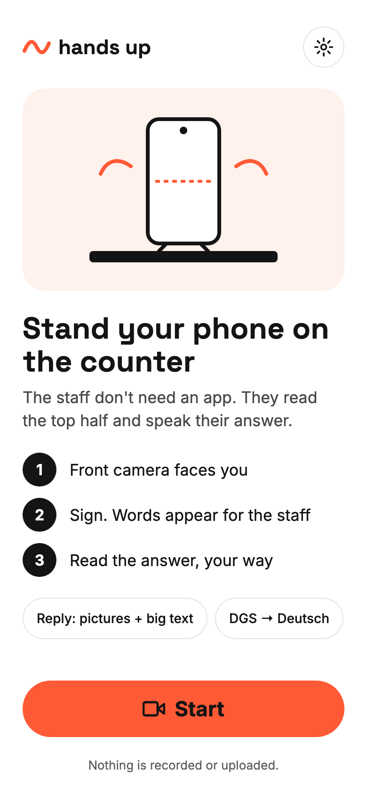
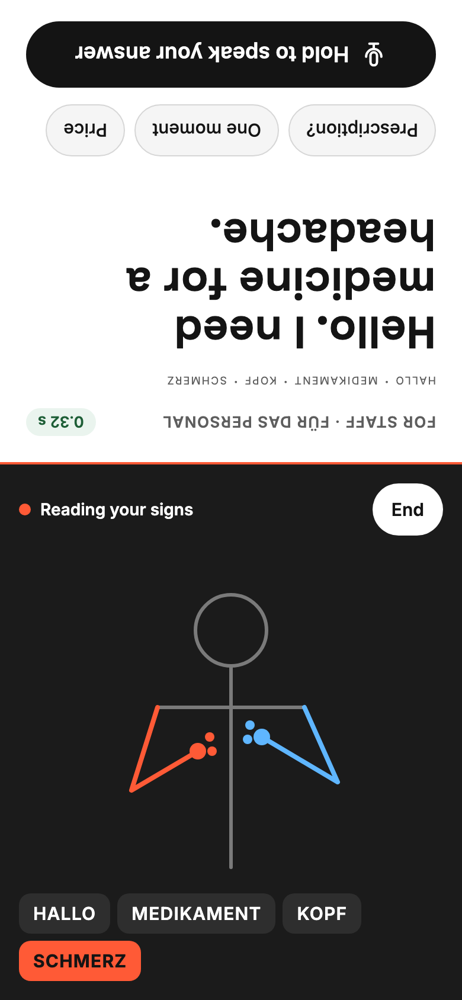
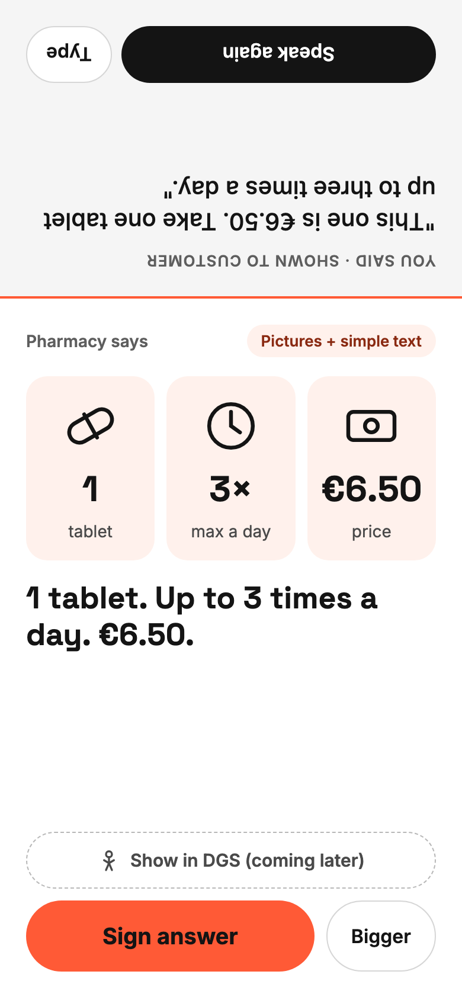
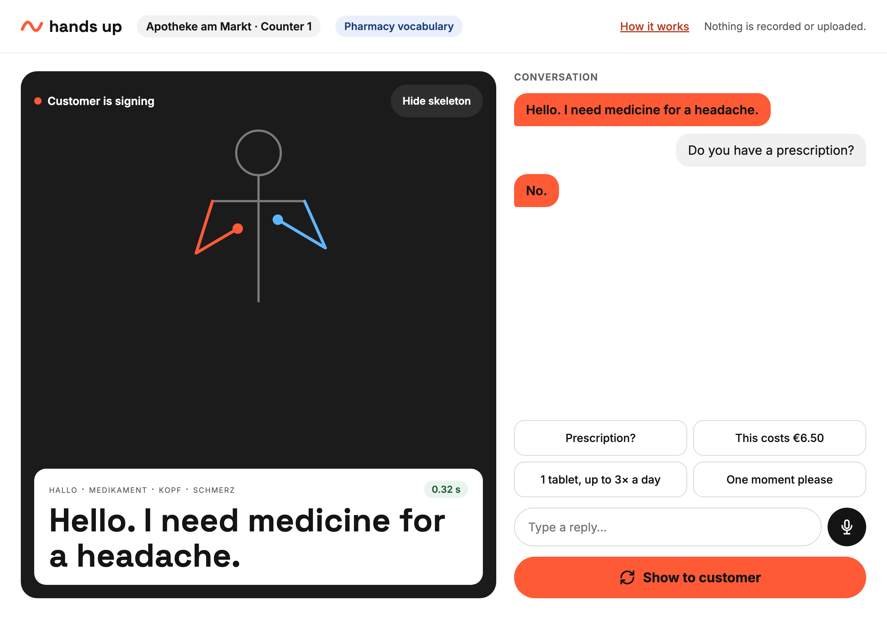
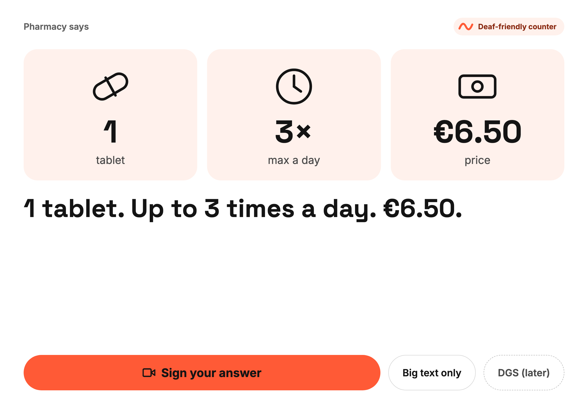

# Hands Up mockups: two modes

These are the screens for the two modes in [PRODUCT-BRIEF.md](../../PRODUCT-BRIEF.md). There are 3 phone screens for **signer mode** (free, on the Deaf person's own phone) and 2 tablet screens for **counter mode** (€49/month, on the business's tablet).

## Signer mode (phone, 390 × 844)

The phone stands on the counter. The bottom half faces the signer. The top half is turned 180° so the staff member can read it from the other side.

| 1. Set up | 2. Signing | 3. Reply, your way |
| --- | --- | --- |
|  |  |  |
| How to stand the phone, reply style, Start | Bottom: camera, skeleton, recognised glosses. Top (for staff): sentence, quick replies, mic | The staff answer as pictures + simple text: 1 tablet · 3× max a day · €6.50 |

## Counter mode (tablet, 1194 × 834)

**4. Staff view:** camera and caption on the left; the conversation, quick replies, text/mic input and "Show to customer" on the right.



**5. Shown to customer:** the last reply in picture style, the "Deaf-friendly counter" badge, and "Sign your answer".



## What's in this folder

| Folder | What it is | How to use it |
| --- | --- | --- |
| `screenshots/` | PNGs at 2× resolution | Look at them on GitHub, or put them in the deck |
| `static/` | Plain HTML pages, one per screen | Open them in any browser. The buttons link the screens together. Fonts load from Google Fonts |
| `source/` | The original files from the design canvas (`.dc.html` + `canvas.json`) | The editable version. They only render inside the canvas editor, so use `static/` to view them |
| `build_static.py` | Turns `source/` into `static/` | `python3 build_static.py source static` |

The editable canvas is on claude.ai: [Hands Up two modes](https://claude.ai/artifact/QrJVepSAJUozuFeSWxMyhA). It's private until Nodir shares it.

## Updating the screenshots

After you change a screen in `source/`, rebuild the static pages:

```bash
python3 build_static.py source static
```

Then re-render the screenshot. Use `390 844` as the window size for phone screens and `1194 834` for tablet screens. The example below re-renders screen 3:

```bash
"/Applications/Google Chrome.app/Contents/MacOS/Google Chrome" --headless=new --hide-scrollbars --force-device-scale-factor=2 --virtual-time-budget=6000 --window-size=390,844 --screenshot="$PWD/screenshots/3-phone-reply.png" "file://$PWD/static/3-phone-reply.html"
```

These are design mockups, not the app. The live demo code is in [`handsup-live/`](../../handsup-live/).
